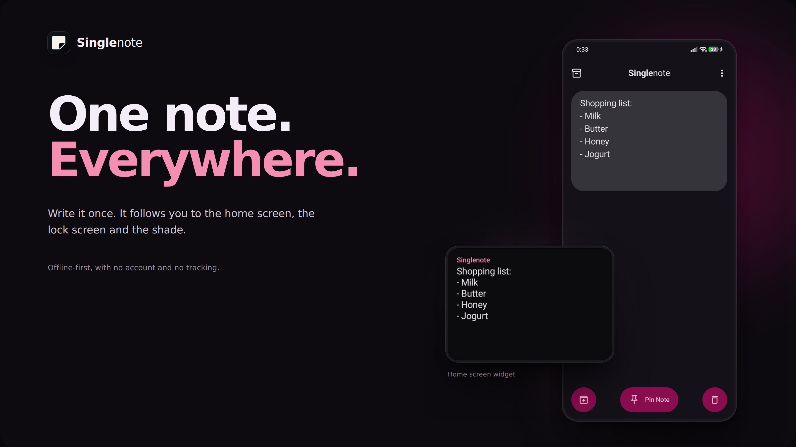
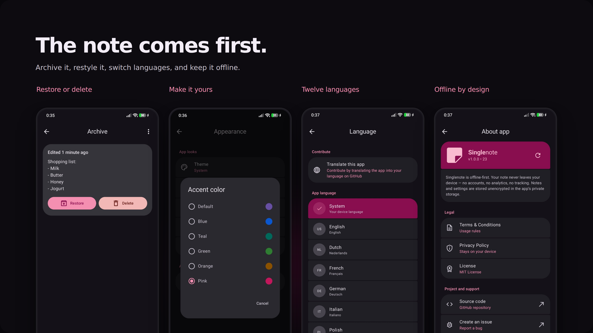
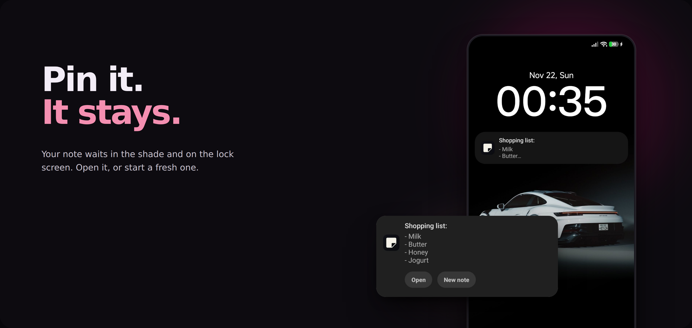
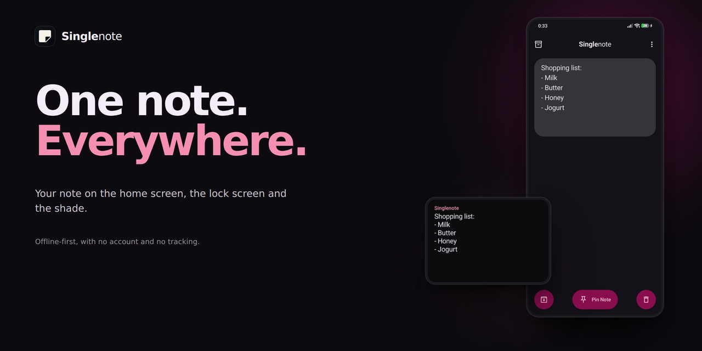
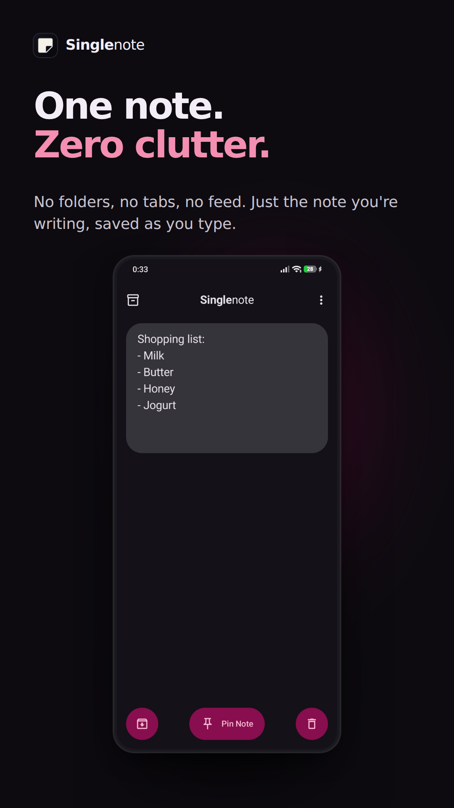
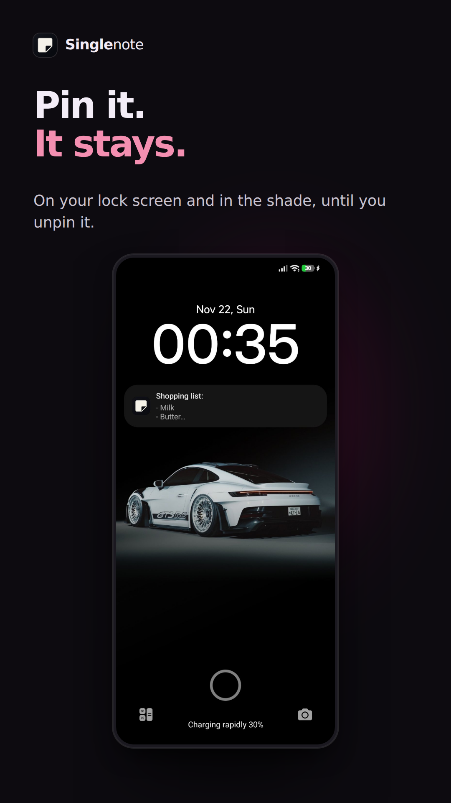
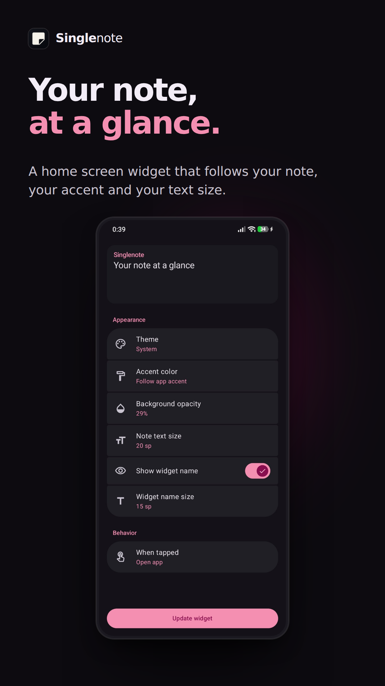
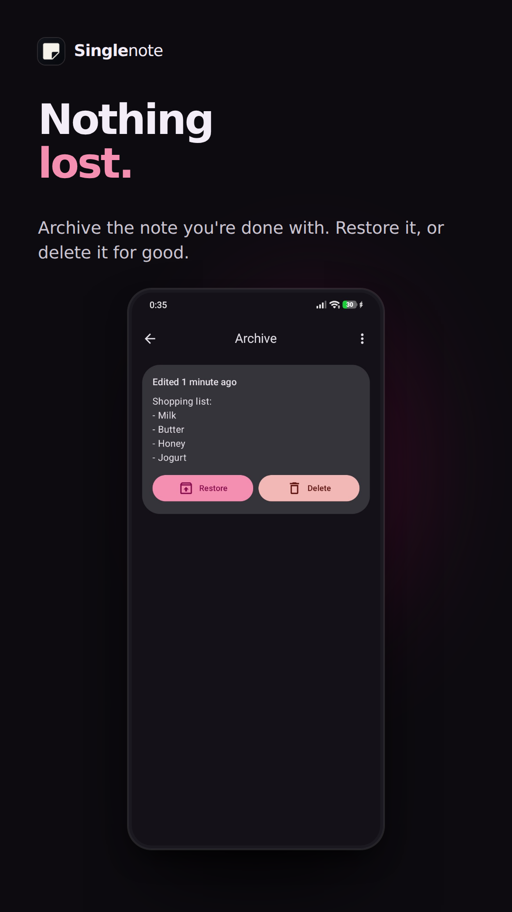
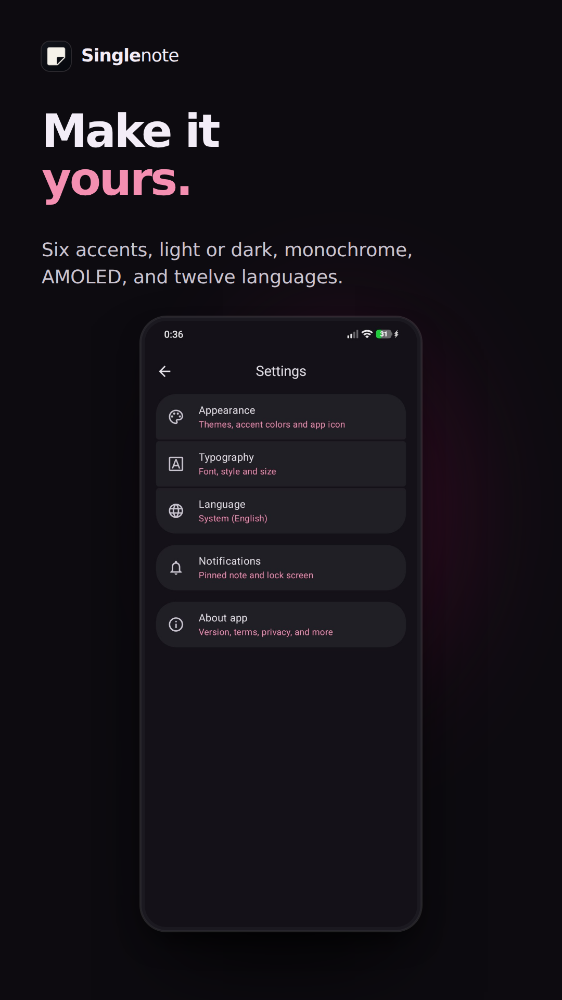
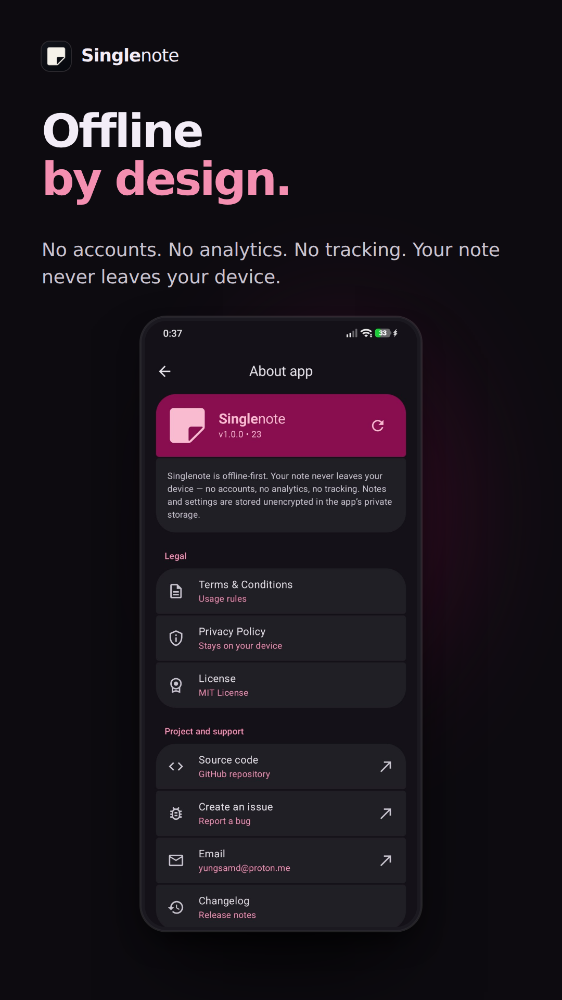

# Showcase and store assets

The images that present Singlenote outside the app: the README set, the social
preview, and the Play Store listing. Every screen is a real app screenshot in a
dark frame — no invented UI.

## What's here

| Asset | Size | Where it goes |
|---|---|---|
| [`hero.png`](hero.png) | 3200×1800 | README hero, press, social posts |
| [`features.png`](features.png) | 3200×1800 | README feature gallery |
| [`notification.png`](notification.png) | 3200×1520 | README pinned-notification section |
| [`social-preview.png`](social-preview.png) | 1280×640 | GitHub repository social preview; X/Twitter and Discord link cards |
| [`store/01-editor.png`](store/01-editor.png) … [`06-privacy.png`](store/06-privacy.png) | 1080×1920 | Play Store phone screenshots, in order |
| [`store/feature-graphic.png`](store/feature-graphic.png) | 1024×500 | Play Store feature graphic |
| [`store/icon-512.png`](store/icon-512.png) | 512×512 | Play Store app icon |

The README images are 3200px wide, so they stay sharp when displayed up to
1600px wide (2×) on high-density screens. Let GitHub scale them; do not set a
display width above 100%.

## Preview









| Editor | Pinned | Widget | Archive | Settings | Privacy |
|---|---|---|---|---|---|
|  |  |  |  |  |  |

## Use them

### GitHub README

Under the badges in the root README:

```html
<p align="center">
  
</p>
```

Place `features.png` and `notification.png` in the feature sections, in that
order. The full sequence is hero → features → notification.

### GitHub repository link preview

1. Repository → **Settings** → **General** → **Social preview**.
2. Upload `social-preview.png` (1280×640, PNG, under 1 MB).

GitHub uses this image for the repository card on GitHub, X/Twitter, Discord,
Slack and most other unfurlers. The left and right copy sits 64 px inside the
canvas, and the phone stays 70 px from the right edge, so X's 1.91:1 crop does
not touch the design.

### Play Store

- **App icon**: `store/icon-512.png` — 512×512, 32-bit PNG, opaque.
- **Feature graphic**: `store/feature-graphic.png` — 1024×500, no alpha.
- **Phone screenshots**: `store/01-editor.png` through `store/06-privacy.png` —
  1080×1920, 9:16, 24-bit PNG.

Upload the screenshots in filename order; Play Store keeps the upload order, not
the filenames. Two screenshots are the minimum; this set ships six.

### X/Twitter and Discord

Sharing the repository URL uses GitHub's social preview. When attaching an image
directly, use `hero.png` for a 16:9 post or `social-preview.png` for a wide link
card. Both are 24-bit PNG and keep clean gradients after platform compression.

## Regenerating

These files are exports, not editable artwork. Change the screenshots in the app,
then rebuild the scenes with the rules in [AGENTS.md](AGENTS.md), capture at 2×
and downscale with Lanczos. Keep the dimensions in the table above exact. Do not
upscale a screenshot, add a fake screen, or paint over a UI edge.

Before replacing an asset, check its dimensions, mode and file size:

```sh
python3 - <<'PY'
from PIL import Image
im = Image.open("docs/showcase/hero.png")
print(im.size, im.mode)
PY
```

## Rules

The palette, frames, crops, approved headlines and the patterns to avoid are in
[AGENTS.md](AGENTS.md). Read it before adding, replacing or reviewing an image.
